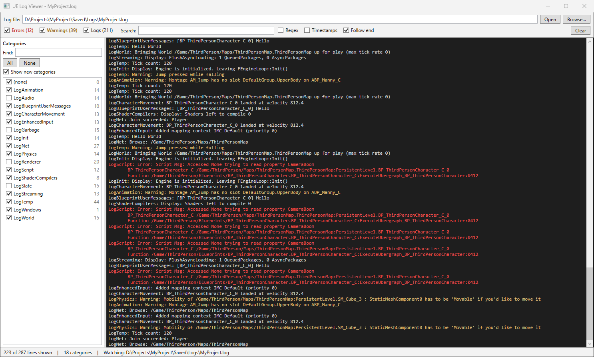

# UE Log Viewer

[](https://github.com/miknios/ue-log-viewer/actions/workflows/ci.yml)
[](https://github.com/miknios/ue-log-viewer/releases/latest)
[](LICENSE)

A standalone Windows viewer for Unreal Engine (UE4 / UE5) log files. Follow a log live or open an old one, and filter it by category, verbosity and text.



## Why

- **Any log.** The live editor log, previous runs (`-backup-` files), game and server logs, logs from other machines, and build/cook logs from UnrealBuildTool and AutomationTool.
- **No editor needed.** Keeps working while the editor is closed, recompiling or crashed.
- **Auto-scroll that works with filters.** The editor's Output Log stops following new lines once any category is hidden. This doesn't.
- **Portable.** One exe, nothing to install.

## Download

Get it from [Releases](https://github.com/miknios/ue-log-viewer/releases/latest):

- `UeLogViewer-<version>-win-x64.zip`: runs as is. **Pick this one if unsure.**
- `UeLogViewer-<version>-win-x64-framework-dependent.zip`: needs the [.NET 9 Desktop Runtime](https://dotnet.microsoft.com/download/dotnet/9.0).

The exe isn't signed, so SmartScreen may warn on first run: **More info → Run anyway**.

## Usage

Run `UeLogViewer.exe`, then **Browse…** to a log or paste its path and press Enter. You can also pass the path as an argument. Project logs are usually in `<Project>\Saved\Logs\`.

Settings are saved in `UeLogViewer.settings.json` next to the exe. Delete it to reset.

## Features

- Live tailing; resets automatically when the engine starts a new log
- Category list with counts, show only / hide, find
- Errors / Warnings / Logs toggles
- Text or regex search
- Follow end: stops when you scroll up, resumes at the bottom
- Callstacks and multi-line messages stay with the line that started them
- Timestamps on/off, copy selected lines

## Building

Requires the [.NET 9 SDK](https://dotnet.microsoft.com/download/dotnet/9.0).

```
dotnet build -c Release
dotnet test -c Release
```

Release builds are made by [`release.yml`](.github/workflows/release.yml) when a `v*` tag is pushed.

## License

[MIT](LICENSE). Unreal Engine is a trademark of Epic Games, Inc. This project is not affiliated with Epic Games.
